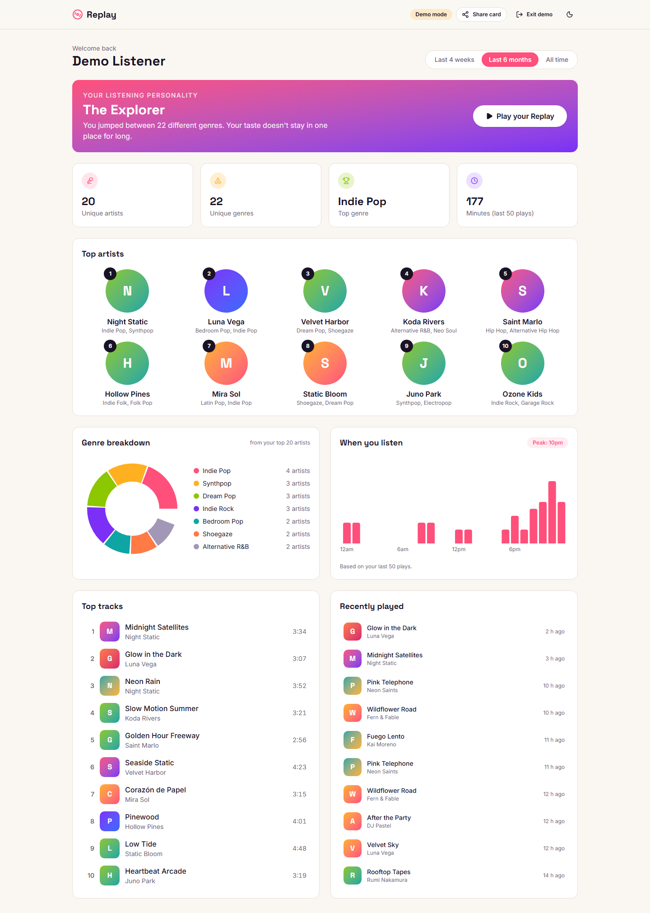
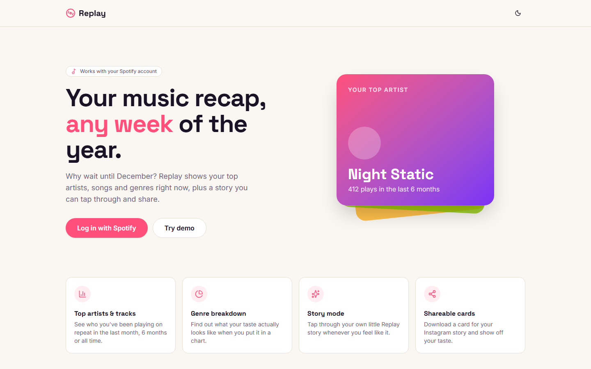
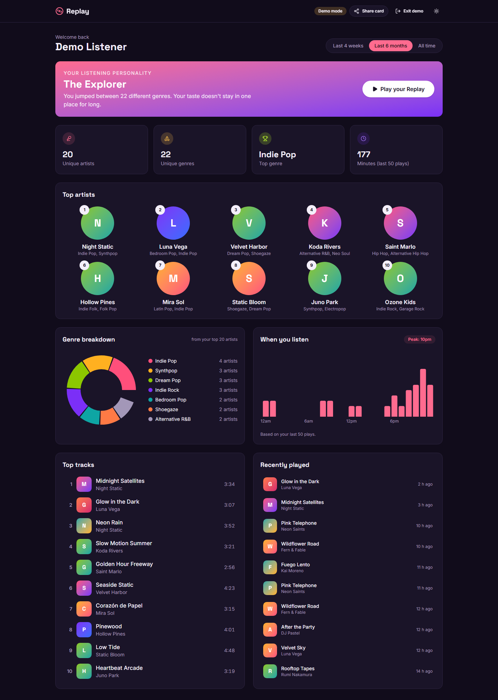
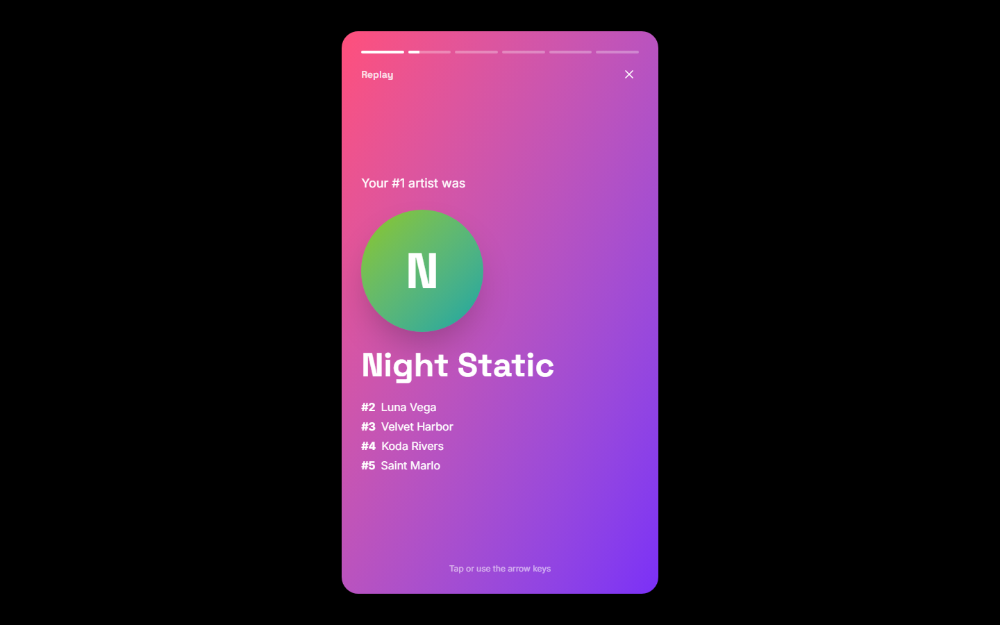
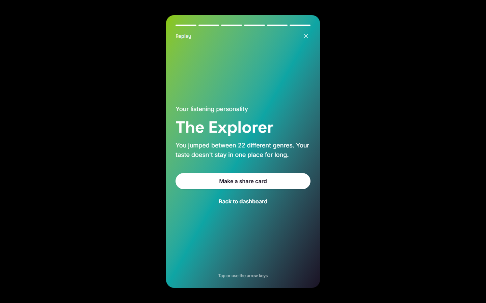
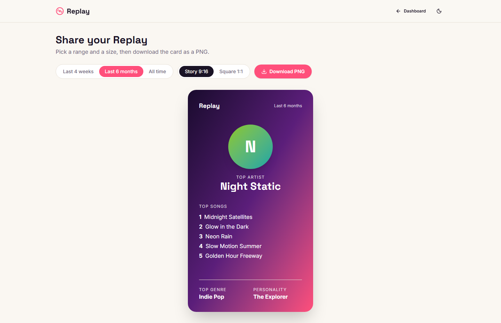
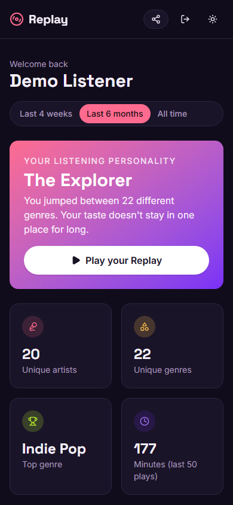
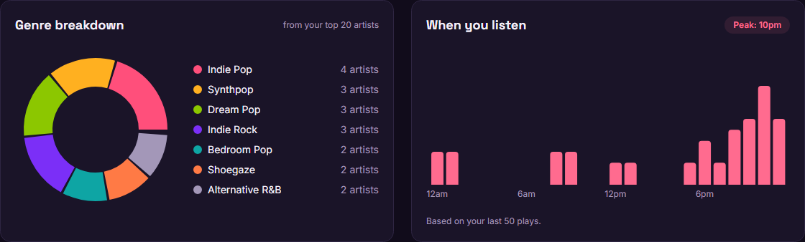

# Replay

Your Spotify stats, any time of the year. Top artists, top tracks, genres, listening habits and a little story you can tap through and share.

**Live demo:** _coming soon_ (you can still try it locally with the **Try demo** button, no Spotify account needed)



## Screenshots

| Landing | Dark mode |
| --- | --- |
|  |  |

| Story mode | Listening personality |
| --- | --- |
|  |  |

| Share card | Mobile |
| --- | --- |
|  |  |



## Features

- **Log in with Spotify** using the Authorization Code flow with PKCE (no backend or client secret needed)
- **Top artists and top tracks** for the last 4 weeks, last 6 months or all time
- **Genre breakdown** donut chart built from your top artists
- **When you listen**: a bar chart of your recent plays by hour of the day
- **Stat cards**: unique artists, unique genres, top genre and minutes listened
- **Listening personality** (The Explorer, The Loyal Fan, The Hitmaker...) based on your genres, artist popularity and how much you repeat your favorite artist
- **Story mode**: full-screen animated slides like the end-of-year recap. Tap, click or use the arrow keys
- **Share card**: download your stats as a PNG, in story (9:16) or square size
- **Demo mode** with made-up data so anyone can try it without logging in
- Light / dark theme, responsive layout, loading skeletons and friendly error messages (expired session, rate limited)
- SEO metadata, sitemap, robots.txt and a dynamic Open Graph image

> Spotify removed the audio features endpoint (energy, danceability, etc.) for new apps in November 2024, so the personality is calculated from genres and popularity instead.

## Tech stack

- [Next.js](https://nextjs.org/) (App Router) + TypeScript
- [Tailwind CSS](https://tailwindcss.com/) + [shadcn/ui](https://ui.shadcn.com/) components
- [Recharts](https://recharts.org/) for the charts
- [html-to-image](https://github.com/bubkoo/html-to-image) for the PNG export
- [next-themes](https://github.com/pacocoursey/next-themes) for dark mode
- [Spotify Web API](https://developer.spotify.com/documentation/web-api)
- Deployed on Vercel

## Getting a Spotify Client ID

1. Go to the [Spotify Developer Dashboard](https://developer.spotify.com/dashboard) and log in.
2. Click **Create app**.
3. Give it any name and description.
4. Under **Redirect URIs** add:
   ```
   http://127.0.0.1:3000/callback
   ```
   (Spotify doesn't accept `localhost` anymore, so use `127.0.0.1`.)
5. Tick **Web API**, accept the terms and save.
6. Open the app settings and copy the **Client ID**.
7. While the app is in development mode, only users you add under **User Management** can log in, so add your own Spotify email there.

## Running it locally

```bash
# 1. clone the repo
git clone https://github.com/sirine2907/spotify-wrapped.git
cd spotify-wrapped

# 2. install dependencies
npm install

# 3. add your client id
cp .env.example .env.local
# then open .env.local and paste your client id

# 4. start the dev server
npm run dev
```

Then open **http://127.0.0.1:3000** (not localhost, or the Spotify redirect won't match).

### Environment variables

| Name | Description |
| --- | --- |
| `NEXT_PUBLIC_SPOTIFY_CLIENT_ID` | Client ID from the Spotify dashboard |
| `NEXT_PUBLIC_SPOTIFY_REDIRECT_URI` | Must match the redirect URI in your Spotify app |
| `NEXT_PUBLIC_SITE_URL` | Your site URL, used for the OG image and sitemap |

### Deploying to Vercel

Import the repo on Vercel, add the same three environment variables (with your Vercel URL), and add `https://your-app.vercel.app/callback` as a redirect URI in the Spotify dashboard.

## Project structure

```
app/
  page.tsx              landing page
  callback/             handles the redirect back from Spotify
  dashboard/            main stats page
  replay/               story mode
  share/                share card + PNG download
  api/og/               dynamic Open Graph image
components/             UI pieces (charts, lists, cards, header...)
  ui/                   shadcn/ui components
lib/
  spotify.ts            login (PKCE), tokens and API calls
  use-spotify-data.ts   hook that loads all the data for a page
  stats.ts              genre counts, listening hours, personality
  demo-data.ts          fake data for demo mode
  types.ts              TypeScript types
scripts/
  screenshots.mjs       takes the README screenshots with Playwright
```

## Screenshots script

The screenshots above were taken in demo mode with Playwright:

```bash
npm run build && npm start
# in another terminal
npx playwright install chromium
node scripts/screenshots.mjs
```

## Disclaimer

Replay is a personal project and isn't affiliated with or endorsed by Spotify.

## License

[MIT](LICENSE)
